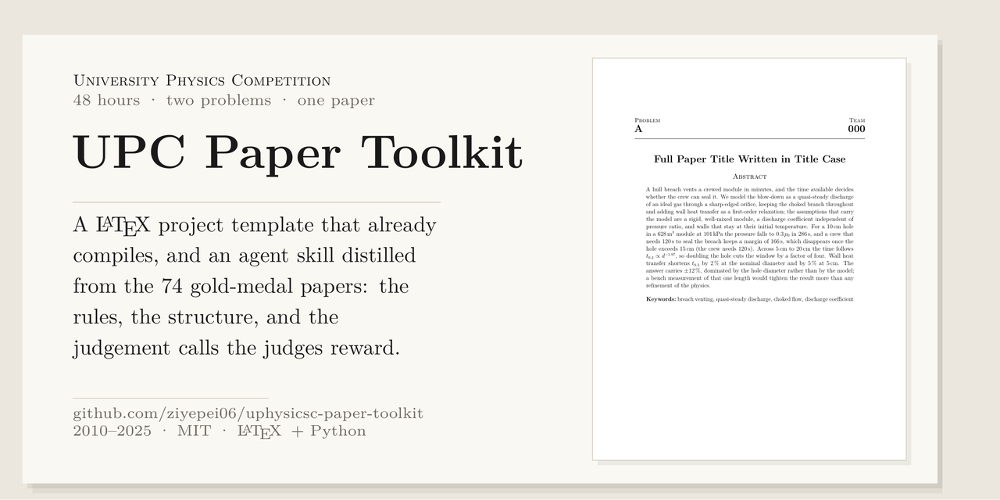
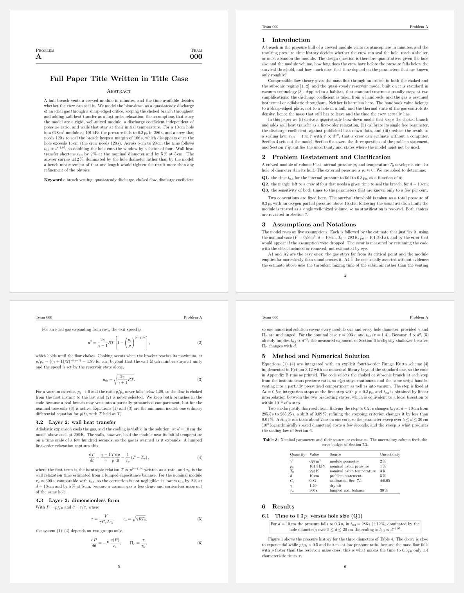

# University Physics Competition — Paper Toolkit

**English** | [中文](README.zh-CN.md)



Everything a University Physics Competition team needs to write the paper:
a **LaTeX project template** that already compiles, and an **agent skill**
that carries the rules, the structure, and the judgement calls — both
distilled from the 74 gold-medal papers published on
[uphysicsc.com](http://uphysicsc.com) between 2010 and 2025.

The competition gives you 48 hours, two problems, and one PDF per problem.
Gold is roughly the top 2%, and most of what separates a gold paper from a
carefully done silver one is not physics — it is whether the reader can find
the assumptions, the answers, and the uncertainty in the first two minutes.



## What is in here

| Path | What it is |
|---|---|
| `template/` | Multi-file LaTeX project: compiles to 13 pages, passes its own compliance checks, carries a complete worked example |
| `skill/upc-paper/` | Agent skill: `SKILL.md`, 10 reference documents, a submission checklist, and the same checker scripts |
| `papers/` | The 74 gold-medal papers, 2010–2025: the organisers' PDFs, plus an index linking each one to its official copy. Copyright stays with the authors — see [`papers/NOTICE.md`](papers/NOTICE.md) |
| `docs/` | Rendered pages used in this README |

`template/` is the same project as `skill/upc-paper/templates/project`, with
its own `tools/` and a Makefile that does not depend on where the skill sits;
the skill keeps its copy so it works on its own. If you edit one,
copy the change to the other — `git diff` between the two directories is
short.

No git? The [latest release](https://github.com/ziyepei06/uphysicsc-paper-toolkit/releases/latest)
has three archives: the skill, the template, and the 74 papers.

Cloning pulls about 220 MB; the working tree alone is 120 MB, almost all of it
the 74 papers:

```bash
git clone https://github.com/ziyepei06/uphysicsc-paper-toolkit.git
```

## The template

Requirements: `latexmk` from any TeX distribution, and Python 3 with PyMuPDF
for the two checker scripts. If an import fails the checker says which one.

```bash
cd template
make            # latexmk + checks: team number, summary length, references, fonts
make pdf        # -> 000A.pdf, i.e. <team><letter>.pdf as the rules require
```

Change three things and you are writing: `config.tex` (team, problem,
title), `sections/00-frontmatter.tex` (the summary), and `sections/01`–`09`
(the body). Every section file opens with a `%% GUIDE` comment saying what
belongs there.

```
template/
├── main.tex              \input order, bibliography
├── config.tex            team number, problem letter, title   <- lead only
├── preamble.tex          geometry, header/footer, macros
├── sections/00-frontmatter.tex   page 1: the four permitted items + summary
├── sections/01-introduction.tex … 09-conclusion.tex
├── sections/10-appendix.tex      derivation, code listing, sweep table
├── sections/11-ai-report.tex     AI-use report, commented out until needed
├── refs.bib              5 real entries; replace with sources you have read
├── code/blowdown.py      the code quoted in the appendix (runs, prints 285.5 s)
├── figures/, scripts/    vector PDFs and the script that generates them
├── tools/                check_pdf.py, count_summary.py, build.sh
└── Makefile, README.md   000A.pdf (compiled example)
```

The layout follows what the gold papers actually do: US Letter, 12 pt
serif, one-inch margins, single column, team number on the left of every
page header and problem letter on the right, a Contents page with dot
leaders (50 of the 74 gold papers have one), numeric citations in order of
appearance, three-line tables, and an answer box for each question.

## The skill

`skill/upc-paper/` is plain Markdown, a LaTeX template and three scripts —
no build step, no package to install. Hand the folder (or `upc-paper-skill.zip`
from the release) to your agent and say what you want it to do; the entry
point is `SKILL.md`, and every file it links to sits beside it. If your agent
needs the skill in a particular directory, it knows where that is.

The skill is deliberately opinionated:

| File | Contents |
|---|---|
| `SKILL.md` | Entry point: non-negotiables, the 48-hour workflow, role split, definition of done |
| `references/official-rules.md` | The 2025 rules, quoted clause by clause, with what to do about each |
| `references/layout-conventions.md` | What the 74 papers look like, measured: pages, columns, fonts, section order |
| `references/writing-patterns.md` | Section-by-section: what the section is for, what it must contain, model sentences, failure modes |
| `references/latex-cookbook.md` | Working LaTeX for equations, wide tables, subfigures, code listings, bibliographies |
| `references/figures-guide.md` | Figure sizes, a colourblind-safe palette, recipes for the eight plot types that recur |
| `references/numbers-and-units.md` | Significant figures, uncertainty propagation, error budgets, scaling laws |
| `references/timeline-and-roles.md` | Hour-by-hour plan, six roles, hand-off format, gates G1–G8 |
| `references/judging.md` | How a judge reads a paper in ten minutes, and where marks are lost |
| `references/exemplars.md` | Eight papers read closely, with what to steal from each |
| `references/exemplar-profiles.md` | All 74 papers, one row each: pages, figures, tables, references, whether they have notations, assumptions, strengths/weaknesses |
| `checklists/submission-checklist.md` | A–I checklist to run before the upload |

## What the 74 gold papers have in common

Measured with PyMuPDF over all papers, 2010–2025:

| | Median | 25th–75th | Range |
|---|---|---|---|
| Pages | 23 | 17–28 | 5–111 |
| Figures | 14 | 8–20 | 0–36 |
| Tables | 1 | 0–4 | 0–18 |
| References | 8 | 4–11 | 0–32 |
| Summary words | 240 | 213–279 | 101–373 |

56 are single column, 18 two-column; 45 are A4 and 29 US Letter; 72 of 74
cite numerically. 30 have an explicit notation table, 66 state assumptions
explicitly, 49 list strengths, 38 list weaknesses, 51 have an appendix.

The statistics are the reason the template looks the way it does — and the
reason the skill says a 20-page paper with 8 figures beats a 40-page paper
with 30, if the 20-page one answers the questions.

## The worked example

The template is not an empty skeleton: it contains a full paper about a
pressure-hull breach — a 628 m³ module venting through a circular hole —
because that problem exercises every part of the structure (a layered
model, one calibrated parameter, a scaling law, an error budget, a figure
produced by the same code that produced the table).

Every number in that paper comes from `code/blowdown.py`. For a 10 cm hole
it prints 285.5 s, the paper quotes 286 s, and the ±12 % error budget says
why the third digit is not worth defending. If you change the model, the
numbers change with it; there is no place where the text and the code can
silently disagree.

## Licence and credits

Code, template, skill, and prose: MIT, © 2026 Ziye Pei (see `LICENSE`).

The 74 gold-medal PDFs in `papers/` are not ours, and that licence does not cover
them. They were written by the teams that won and are published by the University
Physics Competition at [uphysicsc.com](http://uphysicsc.com). The copies here are
unmodified and kept so the papers can be read offline; every row of
[`papers/README.md`](papers/README.md) also links to the file the organisers
publish. Copyright stays with each paper's authors — if you wrote one and want it
removed, open an issue and it goes.

The statistics and the prose in `skill/upc-paper/references/` are ours, derived by
reading those papers.
