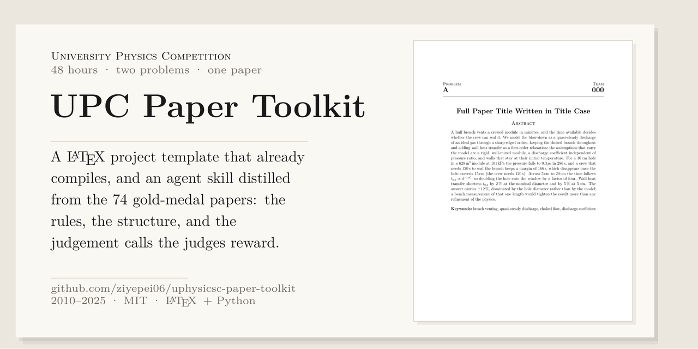
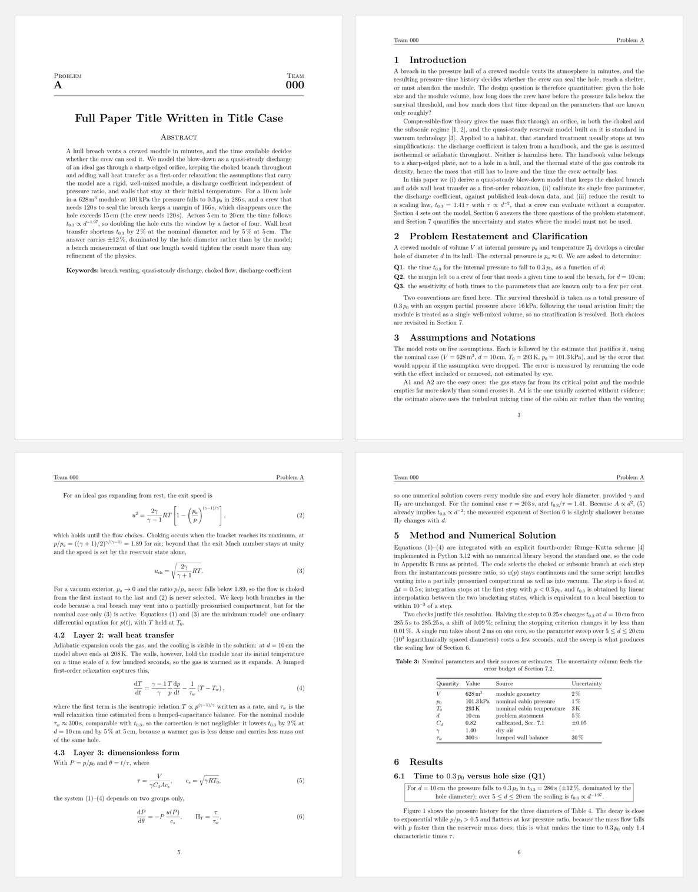

# University Physics Competition 论文工具包

[English](README.md) | **中文**



> 这里的 "UPC" 指 [University Physics Competition](http://uphysicsc.com)（48 小时、
> 两道题、每题一篇论文），**不是**加泰罗尼亚理工大学（Universitat Politècnica de
> Catalunya）——GitHub 上大多数 `UPC-*` 的 LaTeX 仓库属于后者。

一支 University Physics Competition 参赛队写好论文所需的一切：一份**已经能编译**
的 LaTeX 工程模板，以及一份 **agent skill（智能体技能）**——规则、结构、以及真正
影响判分的取舍，都写在里面；两者提炼自 2010–2025 年发表在
[uphysicsc.com](http://uphysicsc.com) 的 74 篇金牌论文。

比赛给你 48 小时、两道题、每题一份 PDF。金牌大约是前 2%。金牌论文和认真做完的
银牌论文之间，差距多半不在物理，而在评委能否在前两分钟里找到假设、答案和不确定度。



## 仓库内容

| 路径 | 是什么 |
|---|---|
| `template/` | 多文件 LaTeX 工程：编译出 11 页，能通过自带的合规检查，内含一份完整的示例论文 |
| `skill/upc-paper/` | agent skill：`SKILL.md`、10 份参考文档、一份交稿检查清单，以及同一套检查脚本 |
| `papers/` | 74 篇金牌论文（2010–2025）的索引，链到主办方自己发布的文件。这里的 PDF **不再分发**——见 [`papers/NOTICE.md`](papers/NOTICE.md) |
| `docs/` | 本 README 用到的页面截图 |

`template/` 和 `skill/upc-paper/templates/project` 是同一套工程：前者自带 `tools/`，
Makefile 不依赖技能放在哪里；技能保留自己的副本，才能独立使用。改了一边，记得把
改动同步到另一边——两个目录之间的 `git diff` 很短。

不想用 git？[最新 release](https://github.com/ziyepei06/uphysicsc-paper-toolkit/releases/latest)
提供两个压缩包：技能和模板。

克隆下来只有几 MB——论文是链接，不是文件：

```bash
git clone https://github.com/ziyepei06/uphysicsc-paper-toolkit.git
```

## 模板

依赖：任意 TeX 发行版里的 `latexmk`，以及装了 PyMuPDF 的 Python 3（给两个检查脚本
用）。导入失败时，检查脚本会告诉你是缺了哪个。

```bash
cd template
make            # latexmk + 检查：队号、摘要长度、参考文献、字体
make pdf        # -> 000A.pdf，即规则要求的 <队号><题号>.pdf
```

只需改三处就能开写：`config.tex`（队号、题号、标题）、`sections/00-frontmatter.tex`
（摘要）和 `sections/01`–`09`（正文）。每个章节文件开头都有一段 `%% GUIDE` 注释，
说明这一节该写什么。

```
template/
├── main.tex              \input 顺序、参考文献
├── config.tex            队号、题号、标题            <- 只有队长要改
├── preamble.tex          版面、页眉页脚、宏
├── sections/00-frontmatter.tex   第 1 页：允许的四项 + 摘要
├── sections/01-introduction.tex … 09-conclusion.tex
├── sections/10-appendix.tex      推导、代码清单、扫描表
├── sections/11-ai-report.tex     AI 使用报告，默认注释掉
├── refs.bib              5 条真实条目；换成你自己读过的文献
├── code/blowdown.py      附录里引用的代码（运行后打印 285.5 s）
├── figures/, scripts/    矢量 PDF 和生成它们的脚本
├── tools/                check_pdf.py、count_summary.py、build.sh
└── Makefile, README.md   000A.pdf（编译好的示例）
```

排版照金牌论文的实际做法：US Letter、12 pt 衬线字体、1 英寸页边距、单栏；页眉左边
队号、右边题号；带点线引导的目录页（74 篇金牌论文里 50 篇有目录）；按出现顺序编号
的数字引用；三线表；每小题一个答案框。

## 技能

`skill/upc-paper/` 就是一堆 Markdown、一份 LaTeX 模板和三个脚本——没有构建步骤，
不用安装包。把整个目录（或 release 里的 `upc-paper-skill.zip`）交给你的 agent，
说清楚要它做什么；入口是 `SKILL.md`，它链接到的每个文件都在旁边。如果你的 agent
要求技能放在特定目录，它知道该放哪。

这个技能是有立场的：

| 文件 | 内容 |
|---|---|
| `SKILL.md` | 入口：不可让步的硬规则、48 小时流程、角色分工、完成标准 |
| `references/official-rules.md` | 2025 年规则逐条引用，并说明每一条该怎么应对 |
| `references/layout-conventions.md` | 74 篇论文长什么样，实测：页数、栏数、字体、章节顺序 |
| `references/writing-patterns.md` | 逐节讲：这一节为什么存在、必须写什么、范例句、常见死法 |
| `references/latex-cookbook.md` | 可直接用的 LaTeX：公式、宽表、子图、代码清单、参考文献 |
| `references/figures-guide.md` | 图幅、色盲友好的配色、反复出现的八种图的画法 |
| `references/numbers-and-units.md` | 有效数字、不确定度传播、误差预算、标度律 |
| `references/timeline-and-roles.md` | 逐小时计划、六个角色、交接格式、检查点 G1–G8 |
| `references/judging.md` | 评委如何在十分钟内读完一篇论文，分数丢在哪 |
| `references/exemplars.md` | 精读八篇论文，每篇写明可以拿走什么 |
| `references/exemplar-profiles.md` | 全部 74 篇，一篇一行：页数、图、表、参考文献，有没有符号表、假设、优点与不足 |
| `checklists/submission-checklist.md` | 上传前要跑一遍的 A–I 检查清单 |

## 74 篇金牌论文的共同点

用 PyMuPDF 统计 2010–2025 年全部论文：

| | 中位数 | 25%–75% 分位 | 范围 |
|---|---|---|---|
| 页数 | 23 | 17–28 | 5–111 |
| 图 | 14 | 8–20 | 0–36 |
| 表 | 1 | 0–4 | 0–18 |
| 参考文献 | 8 | 4–11 | 0–32 |
| 摘要词数 | 240 | 213–279 | 101–373 |

56 篇单栏、18 篇双栏；44 篇 A4、29 篇 US Letter；74 篇里 72 篇用数字引用。30 篇有
明确的符号表，66 篇明确写出假设，49 篇列出优点，38 篇列出不足，51 篇有附录。

这些统计就是模板长成现在这样的原因，也是技能里那句话的来由：一篇把问题全部回答完
的 20 页、8 张图的论文，胜过 40 页、30 张图却答非所问的那篇。

## 示例论文

模板不是空骨架：里面有一篇完整论文，写压力壳破裂——一个 628 m³ 的舱体通过圆孔泄压
——因为这道题把结构的每一部分都用上了（分层模型、一个校准参数、一条标度律、一份
误差预算，以及由生成表格的同一份代码画出的图）。

那篇论文里的每个数字都来自 `code/blowdown.py`。10 cm 的孔，它打印 285.5 s，论文写
286 s，±12% 的误差预算解释了为什么第三位有效数字不值得坚持。改了模型，数字跟着变；
不存在正文与代码悄悄不一致的地方。

## 许可与致谢

代码与文字：MIT，© 2026 Ziye Pei（见 `LICENSE`）。74 篇论文不在仓库里，版权属于
各自作者：[`papers/README.md`](papers/README.md) 链到 uphysicsc.com 上的官方文件，
而不是托管它们，原因见 [`papers/NOTICE.md`](papers/NOTICE.md)。`references/` 里的
统计与文字是我们的，来自阅读这些论文。
